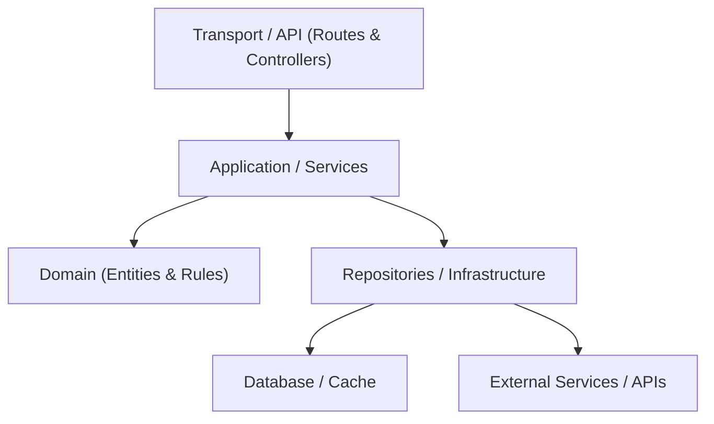

# 🏛️ Arquitectura Global del Proyecto — [Nombre del Proyecto]

> Última actualización: YYYY-MM-DD (Auditoría `$archi`: Cobertura 100% modularizada en `overview/architecture/`)

## 1. Visión General y Capas del Sistema

| Capa | Ubicación | Descripción Breve |
|---|---|---|
| **Routes / Controllers** | `src/routes/` o `app/routers/` | Endpoints HTTP y validación de entrada |
| **Services / Use Cases** | `src/services/` | Lógica de negocio pura |
| **Repositories** | `src/repositories/` | Acceso a datos y abstracciones de DB |
| **Infrastructure** | `src/infra/` | ORM, clientes externos, caché |

## 2. Diagrama de Estado y Persistencia Global

## 3. Índice de Módulos (Subdocumentos de Dominio)
* 📦 **[Módulo Principal](./architecture/modules/principal.md):** Especificación técnica y flujo operativo principal.

## 4. Guías Transversales
* 🧭 **[Mapa Global de Endpoints](./architecture/routes_map.md)** — Enrutamiento de endpoints HTTP/RPC y middlewares.
* 🔄 **[Flujo de Datos](./architecture/core/data_flow.md)** — Estado global, sync y persistencia.
* 📏 **[Reglas de Importación](./architecture/core/import_rules.md)** — Convenciones de capas e importaciones.
