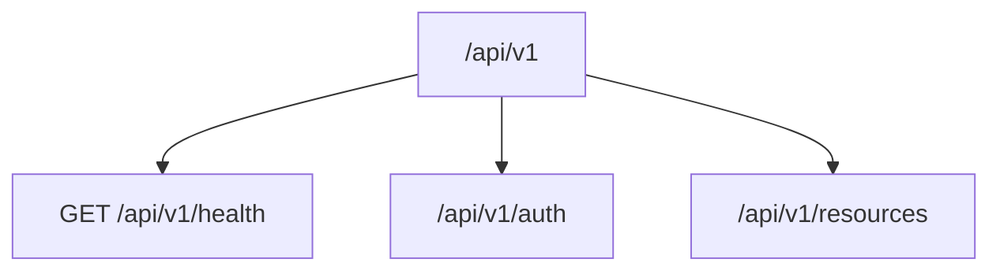

# 🧭 Mapa Global de Rutas y Puntos de Entrada

> Pertenece a: `overview/architecture/routes_map.md`  
> Referenciado desde: [`overview/architecture.md`](../architecture.md)

## 1. Diagrama Sintético de Enrutamiento

## 2. Definición de Endpoints Registrados

| Método & Ruta | Controlador / Handler | Middlewares / Auth |
|---|---|---|
| `GET /api/v1/health` | `HealthController.check` | Público |
| `POST /api/v1/auth/login` | `AuthController.login` | Rate Limit + Validation |
| `GET /api/v1/resources` | `ResourceController.list` | JWT / Session Auth |
